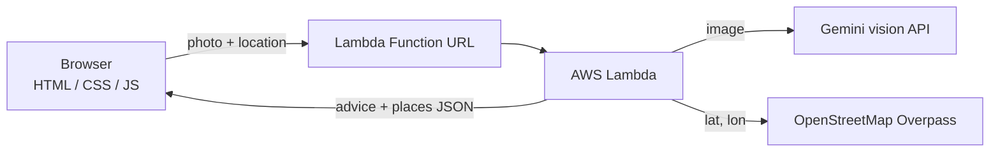

<div align="center">

# ♻️ BinBuddy

**Snap it. Sort it. Sell it. Recycle it.**

Take a photo of any old household item and instantly learn what it is, where it belongs, what it is worth, and who nearby will take it.

</div>

---

## Overview

Most people want to dispose of waste responsibly but do not know how. Chargers, batteries and old phones contain toxic materials and end up in landfills, while many household items still carry scrap value that goes to waste. Local kabadiwalas and e-waste recyclers do vital work, but they are hard to find.

BinBuddy turns a single photo into a clear next step: what the item is, how to dispose of it, what it can sell for, and who nearby will collect it.

## Screenshots

| Home | Analysis result |
|---|---|
|  |  |

| Nearby collection points | Pickup message |
|---|---|
|  |  |

## Features

- **Instant identification:** recognises the item from one photo.
- **Smart classification:** e-waste, hazardous, dry recyclable, wet/organic or reusable.
- **Disposal guidance:** where the item goes and why it matters.
- **Scrap value estimate:** a rough resale value in rupees.
- **Nearby collection points:** scrap shops and recyclers within 7 km, with one-tap directions.
- **Pickup message:** a ready-to-send message in English or Hindi, shared through WhatsApp.
- **No friction:** no sign-up, works in any phone browser.

## How It Works



1. The browser resizes the photo to 1024 px and sends it with the user's location.
2. AWS Lambda calls the vision model to identify the item, classify it, estimate its value and draft the pickup messages.
3. Lambda also queries OpenStreetMap for scrap and e-waste points near the user.
4. A single JSON response is returned and rendered in the page.

## Built on AWS

| Service | Purpose |
|---|---|
| AWS Lambda | Serverless backend written in Python 3.12 |
| Lambda Function URL | Public HTTPS endpoint for the API, with CORS |
| AWS IAM | Execution role and permissions for the function |
| Amazon S3 | Static website hosting for the frontend |

The backend supports two model providers, selected with the `AI_PROVIDER` environment variable: `gemini` (default) and `bedrock` (Amazon Nova). The deployed version uses Gemini because Amazon Bedrock access was not available on the author's AWS account during the hackathon.

## Tech Stack

| Layer | Technology |
|---|---|
| Frontend | HTML, CSS, vanilla JavaScript |
| Backend | Python 3.12 on AWS Lambda |
| AI | Gemini API (Amazon Bedrock supported) |
| Places | OpenStreetMap Overpass API |
| Sharing | WhatsApp click-to-chat |

## Project Structure

```
binbuddy/
├── backend/
│   └── lambda_function.py
├── frontend/
│   ├── index.html
│   ├── style.css
│   └── app.js
└── screenshots/
```

## Getting Started

### 1. Deploy the backend

1. Create a Lambda function with Python 3.12, 256 MB memory and a 1 minute timeout.
2. Paste in `backend/lambda_function.py` and click **Deploy**.
3. Add these environment variables:

| Variable | Description |
|---|---|
| `AI_PROVIDER` | `gemini` or `bedrock` |
| `GEMINI_API_KEY` | Your Gemini API key |
| `GEMINI_MODEL` | A Gemini Flash model name |

4. Create a Function URL with auth type `NONE`, and enable CORS for the `POST` method and the `content-type` header.

### 2. Connect the frontend

Set the `API_URL` constant in `frontend/app.js` to your Function URL.

### 3. Host the frontend

Upload the files in `frontend/` to an S3 bucket with static website hosting enabled. Serve the page over HTTPS so the browser allows location access.

## AI Tools Used

- **Claude** (Anthropic): code assistance and documentation.
- **Gemini API** (Google): runtime vision model for identification, advice and pickup messages.

---

> Built for Environmental Hacks · Bharat Builds Tour · WeMakeDevs × AWS